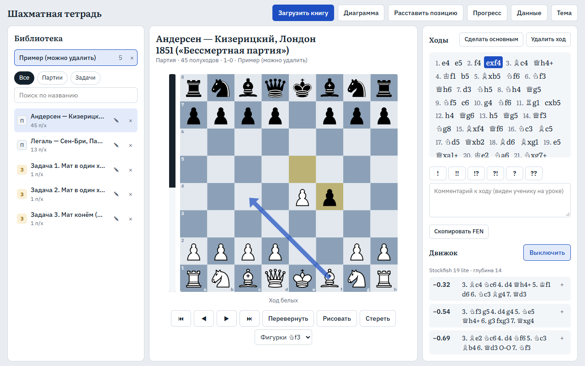
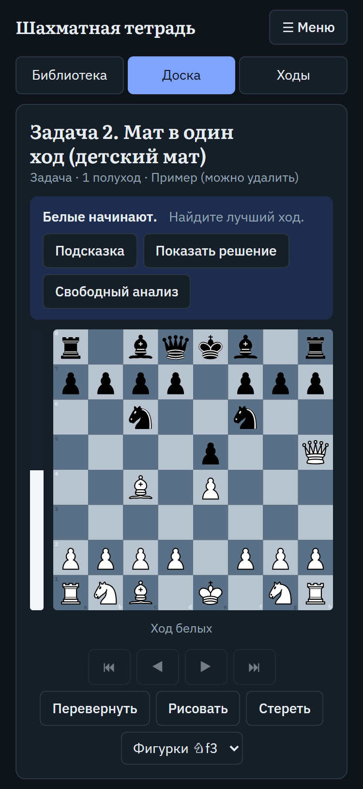
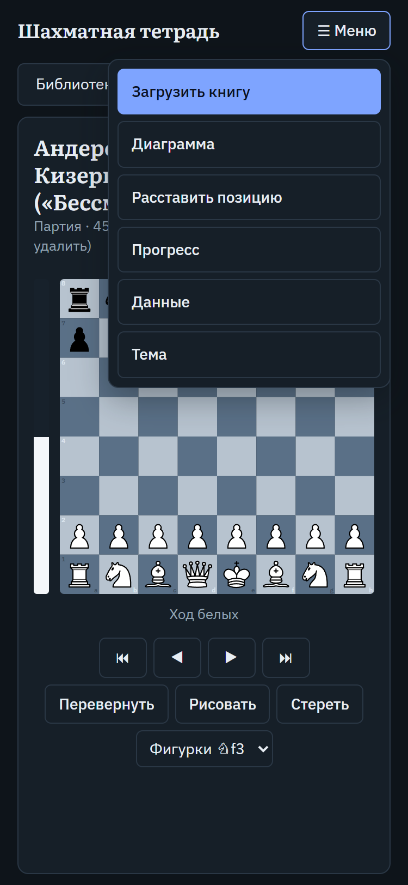

# Шахматная тетрадь

Chess notebook for a coach and students: games with variations, comments and arrows,
puzzles with spaced repetition, import of books (PDF, EPUB, DOCX, PGN), diagram recognition.
Installable PWA that works offline, with Stockfish 19 (lite, WASM) built in.

**Открыть приложение:** https://shakh-jpg.github.io/chess-tetrad/

| Компьютер | Телефон: задача | Телефон: меню |
|---|---|---|
|  |  |  |

**Записать партию:** «Новая партия» (в библиотеке или в меню) — ходы записываются, пока вы двигаете
фигуры, партия сохраняется после каждого хода в книгу «Мои партии», заголовки и результат — кнопкой
«Заголовки», экспорт — «Данные → PGN». Движок при записи выключен (включается кнопкой).

**Онлайн-урок** (общая доска «тренер → ученики») — в планах (этап 5). Сейчас: задания и прогресс
через «Аккаунт», когда облако подключено; без облака всё работает на устройстве.

## Для ученика: как установить за 3 шага

**iPhone / iPad**
1. Откройте ссылку выше в **Safari** (именно Safari).
2. Нажмите кнопку **«Поделиться»** — квадрат со стрелкой вверх.
3. Выберите **«На экран „Домой“»** и нажмите **«Добавить»**.

**Android**
1. Откройте ссылку выше в **Chrome**.
2. Нажмите **«Установить»**: в меню приложения (☰ Меню → Установить) или в меню Chrome (⋮ → «Установить приложение»).
3. Подтвердите. Значок «Тетрадь» появится на главном экране.

После первого открытия приложение работает **без интернета**: задачи, партии и движок.
Ваши книги и прогресс хранятся только на этом устройстве — время от времени делайте копию
в разделе «Данные».

## Исходный код и лицензия (GPL)

Приложение — свободная программа под лицензией **GNU GPL версии 3 или новее** (файл `LICENSE`).
В нём работает шахматный движок Stockfish, который тоже распространяется под GPL-3.0, поэтому
весь исходный код приложения открыт: https://github.com/shakh-jpg/chess-tetrad

Вы можете изучать, изменять и распространять программу на условиях GPL. Если вы распространяете
изменённую версию, её исходный код тоже должен быть открыт под GPL.
Лицензии всех встроенных компонентов (Stockfish, chess.js, pdf.js, шрифты, фигуры cburnett) —
в `LICENSES.md`. Книги и данные пользователей в репозитории не хранятся.

## Commands

```
npm install
npm run dev       # local dev server on http://127.0.0.1:5173 (no service worker in dev)
npm test          # unit tests (Vitest)
npm run build     # production build into dist/ (copies the engine, writes dist/sw.js)
npm run preview   # serve dist/ on http://127.0.0.1:4173
npm run icons     # re-render public/icons/*.png (only when the icon design changes)
npm run lint      # ESLint
npm run typecheck # tsc --noEmit for files marked // @ts-check
npm run e2e       # Playwright end-to-end tests on the build (locally: installed Edge)
npm run screenshots # re-render docs/img/*.png
```

## Layout

| Folder | What is inside |
|---|---|
| `src/core` | vendored chess.js, move tree (`tree.js`), `Core` facade |
| `src/pgn` | tokenizer and book/PGN parser |
| `src/board` | SVG board, cburnett piece set, FEN helpers |
| `src/pdf-import` | file readers (PDF, EPUB, DOCX, FB2, HTML) and the PDF puzzle-book parser |
| `src/recognition` | diagram recognition and user samples |
| `src/engine` | engine adapter (Stockfish worker / fallback worker), UCI parsing |
| `src/storage` | IndexedDB store (persistence request, write-error reporting) |
| `src/srs` | spaced repetition (pure functions) |
| `src/live` | live lesson (works only inside claude.ai for now) |
| `src/pwa` | service worker registration, install button, iOS hint |
| `src/ui` | `app.js` (moves, solving, navigation, rendering, events), `state.js`, `dialogs.js`, `*-dialog.js` (import, editor/diagram, progress, data), `library.js` / `moves-view.js` (escaped markup), `backup.js`, `account.js`, phone menu |
| `scripts` | engine copy, service-worker template and Vite plugin, icon renderer |
| `public` | manifest, icons; `public/engine/` is generated (git-ignored) |
| `e2e` | Playwright end-to-end tests and README screenshots |
| `tests` | Vitest tests; `equivalence.test.js` compares the parser with the original prototype |

## Offline

`dist/sw.js` precaches every built file (about 4 MB: app, Stockfish, pdf.js, fonts, icons).
The engine is single-threaded, so no special server headers are needed (works on GitHub Pages).

License: GPL-3.0-or-later, see `LICENSE` and `LICENSES.md`.
